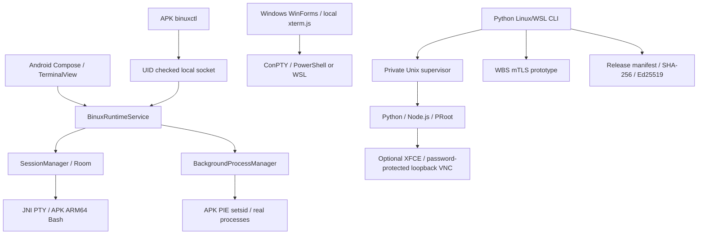

# 1. 전체 아키텍처

Android 앱과 Windows 앱은 독립된 패키지입니다. Termux 앱이나 설치 환경에 의존하지 않습니다. Termux의 터미널 라이브러리 소스를 재사용하며, binux의 패키지/설정/프로세스 계층은 별도로 구성합니다. 호스트 Python 도구는 검증 및 후속 런타임 통합용이며 Android에 자동 설치되지 않습니다.

Android Bash와 관리 실행파일은 APK nativeLibraryDir에서만 실행합니다. Windows native 명령과 WSL Linux 명령은 런타임 선택으로 구분합니다. PRoot는 Android 커널을 바꾸거나 실제 관리자 권한을 제공하지 않습니다. UI 프로세스와 별도 Android 앱 프로세스가 아니라, 서비스 수명과 Activity 수명을 분리합니다. 따라서 앱 프로세스가 죽으면 서비스도 종료될 수 있습니다.
