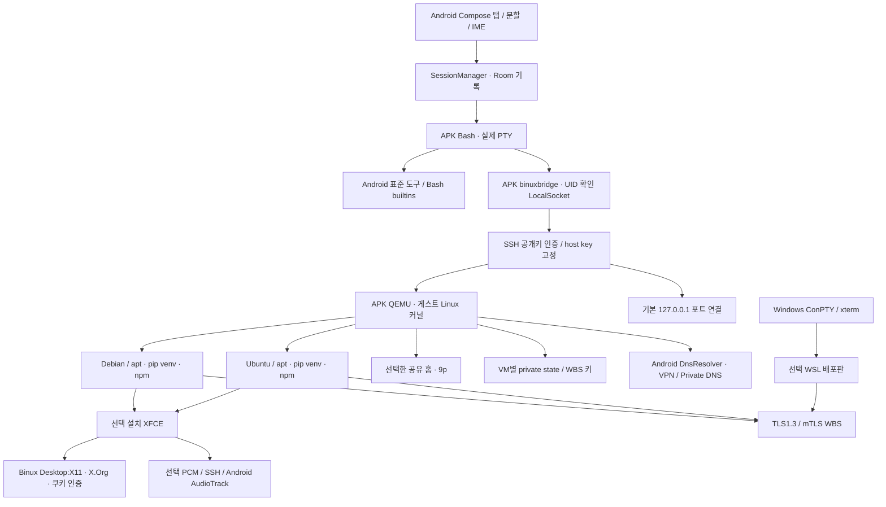

# 1. binux 1.0 아키텍처

Android 프로세스는 앱 UID로 실행하며 Linux VM의 sudo/root와 구분합니다. QEMU와
Bash/bridge는 APK의 패키지 관리 디렉터리에서 실행합니다. 다운로드한 게스트 ELF는
게스트 커널이 실행하며 Android execve에 전달하지 않습니다. PRoot 호스트 어댑터는
Linux/WSL 도구에서 별도로 유지하고 VM을 fake-root로 표시하지 않습니다.

UI와 프로세스는 foreground service로 분리합니다. native 세션/작업은 Android PID
시작시간을 확인하며 이전 PID를 재사용하지 않습니다. 게스트 작업은 SSH와 실제 PTY,
UUID 토큰·프로세스 그룹으로 관리합니다. 전체 중지는 VM도 종료합니다. 종료 기록은
실행 중으로 복원하지 않습니다. 재부팅 재실행은 전역 opt-in과 작업별 opt-in이 필요합니다.

일반 apt/pip/npm과 공식 add-on은 분리합니다. 런타임 이미지의 크기·SHA-256은 APK에
고정하고 공식 add-on은 SHA-256/Ed25519를 검증합니다. Desktop은 요청하기 전까지
설치하지 않습니다. Android API/OEM의 실행 제한 및 실제 검증 범위는 [상태표](STATUS.md)에
구분해 기록합니다.
